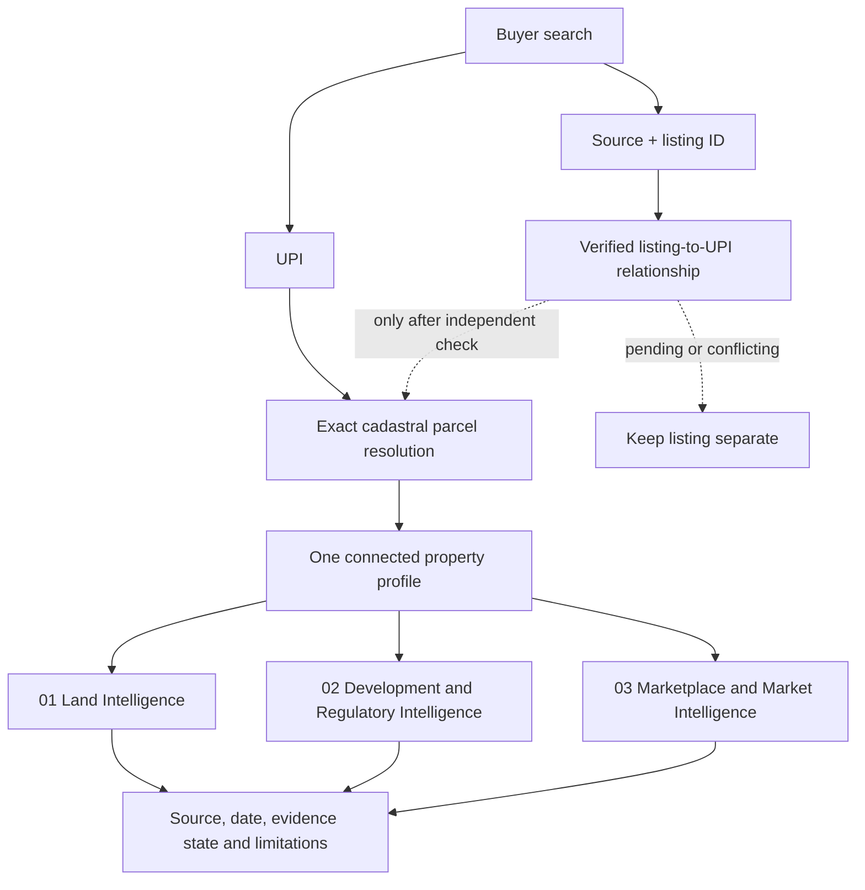

# Taiseel Architecture and Data Flow

## Runtime overview

The application is a MapLibre-based Next.js interface. The same repository has two production deployment paths: Vercel and a Cloudflare Worker using the Vinext build. They are separate deployments of the same source revision. The Cloudflare parcel API also has a guarded server-to-server failover to the Vercel production parcel API when every primary parcel GIS provider fails inside the Worker runtime; the Vercel API does not use that failover, so the request cannot loop.

~~~mermaid
flowchart TD
  GH[GitHub main] --> V[Vercel production build]
  GH --> GA[GitHub Actions]
  GA --> CF[Cloudflare Worker build and deploy]
  V --> UI[MapLibre web application]
  CF --> UI
  UI --> API[Geography and parcel API routes]
  API --> GEO[Official geography and cadastral services]
  API -- "Worker only, when all primary providers fail" --> VP[Vercel production parcel API]
  VP --> GEO
  UI --> REF[Price snapshots and benchmark modules]
  UI --> ACCESS[Nearby access API]
  ACCESS --> OSM[OpenStreetMap Overpass amenities]
  ACCESS --> VAL[Valhalla road routing]
~~~

Vercel and Cloudflare each serve a deployed application and remain independently buildable. If every primary parcel query fails inside Cloudflare, the Worker makes one bounded server-to-server request to the Vercel production parcel API and accepts only GeoJSON features marked as cadastral parcels with a UPI. The Vercel route does not use this fallback, preventing recursion. The response records the fallback source and primary-provider warning. If the fallback fails validation or times out, the Worker returns its explicit 502 rather than inventing parcel outlines.

## Buyer property intelligence flow

The buyer-facing target is one property profile composed from three independent evidence layers. The UPI identifies a parcel; it is not a listing ID. A listing starts as its own source record and can be attached to the parcel only after an explicit, independently checked listing-to-UPI relationship exists.

The diagram below is the **target buyer flow**. The cadastral UPI lookup and part of the project directory already exist. Listing-ID resolution, a verified relationship workflow and complete regulatory and transaction evidence remain integration work; the diagram must not be read as proof that those feeds are live.



### Layer boundaries

| Layer | Canonical subject | Evidence that belongs here | Never infer |
|---|---|---|---|
| Land Intelligence | Parcel / UPI | Cadastral geometry and attributes, mapped area, zoning and sourced planning constraints | Ownership, title, encumbrances, permission to build or physical access |
| Development and Regulatory Intelligence | Project, developer and authority record | Project register, registration where required, approvals, conditions and source-dated compliance evidence | Approval or compliance from a project directory entry or nearby project marker |
| Marketplace and Market Intelligence | Source listing, comparable and transaction record | Advertiser, listing status, asking price, comparable observations and completed transactions | Sale from an advert disappearing, transaction from asking price, or parcel price from an area average |

A profile may show all three layers even when some are incomplete. Each fact carries its own evidence state. Do not collapse the whole profile into one “verified” status. A missing record means it was not found in the connected source; it does not establish that the real-world feature or event does not exist.

### Listing-to-parcel identity gate

- Preserve the listing's source name and source listing ID.
- Preserve the candidate UPI and the method/evidence used to associate the listing with it.
- Require an independent check before the association is treated as verified.
- Keep pending, rejected, expired or conflicting relationships separate from the parcel's confirmed profile.
- Never use nearest coordinates, a shared street, matching district/sector text or a fuzzy property name as identity proof.

See [Buyer Property Intelligence](BUYER_PROPERTY_INTELLIGENCE.md) for the buyer-facing contract, source maturity and acceptance criteria.

## Parcel evidence path

~~~mermaid
flowchart TD
  SELECT[User selects mapped parcel] --> GEOM[Published cadastral geometry]
  SELECT --> DETAIL[Parcel detail panel]
  GEOM --> ID[UPI and parcel attributes when supplied]
  DETAIL --> ZONE[Geometry-based zoning lookup]
  DETAIL --> PRICE[Published price or calculated reference]
  PRICE --> BASIS[Label source, calculation and area basis]
  DETAIL --> ACCESS[Nearby place discovery and road route]
  ID --> NOTE[Show data-quality caveats]
  ZONE --> NOTE
  BASIS --> NOTE
  ACCESS --> NOTE
~~~

## Source roles and limitations

| Data path | Purpose | Important limitation |
|---|---|---|
| Kigali City Master Plan services | Kigali administrative and parcel geometry, plus relevant planning layers | Geometry does not verify title or ownership |
| Geodata Rwanda Bugesera masterplan services | Bugesera administrative/planning context | Individual parcel coverage and reuse permissions require separate verification |
| NLA-hosted LAIS Bugesera parcel service | Bugesera parcel records and attributes | Public access does not establish reuse permission, completeness, or current survey accuracy |
| Zoning feature services | Intersect parcel geometry with published planning areas | A zoning intersection is not proof of legal build permission or title |
| Transaction-price TSV and benchmark modules | Area-level price references | Reference snapshots are not automatically a parcel asking price or a live market feed |
| OpenStreetMap Overpass | Nearby school, health, and transport candidates | Amenity coverage can be incomplete |
| Valhalla | Estimated road distances and times | Not live traffic; omit route metrics if no usable route is returned |
| Resend | Optional contact email delivery | Only active when valid runtime sender, recipient, and API-key settings are configured |

## Data integrity rules

- Never replace missing parcel outlines with guessed boundaries from roads, imagery, or zoning.
- Keep source geometry, listing/asking-price data, transaction references, and calculated estimates distinct.
- Show the source and its caveats near the value that depends on it.
- A source record count is not evidence that the geographic coverage is complete.
- Keep provider credentials in secret stores; never hard-code secrets or place them in browser-visible variables unless they are explicitly designed to be public.
- Keep the Vercel and Cloudflare deploy workflows independently verifiable.


## Project discovery and report path

The project directory is a separate discovery surface over `RWANDA_PROJECT_RECORDS`. It filters the current project register locally with the weighted, multi-field matcher in `src/lib/project-search.js`. Search can rank project name, internal ID, parcel UPI, developer, administrative location, category, owner, status and route; it returns the original records and does not generate project facts.

Project reports follow this evidence path:

```text
Project register + source references
        ↓
Project-specific report facts and calculations
        ↓
Canonical five-page report sequence
        ↓
Shared report stylesheet + residential/commercial presentation
```

The five page keys are `profile`, `scope`, `delivery`, `market` and `location`. The asset profile controls terminology and comparisons: residential reports use homes and bedrooms; commercial reports use spaces, suites, uses and floor areas. Prices must retain currency, area basis, period, source and observation date. A common report shell must never imply that two project records share facts, images, pricing or availability.

See `public/valia-deck/report-standard.json` for the current report contract and `docs/ZILLOW_PATTERN_ADAPTATION.md` for the reviewed open-source patterns and explicit non-adoptions.
